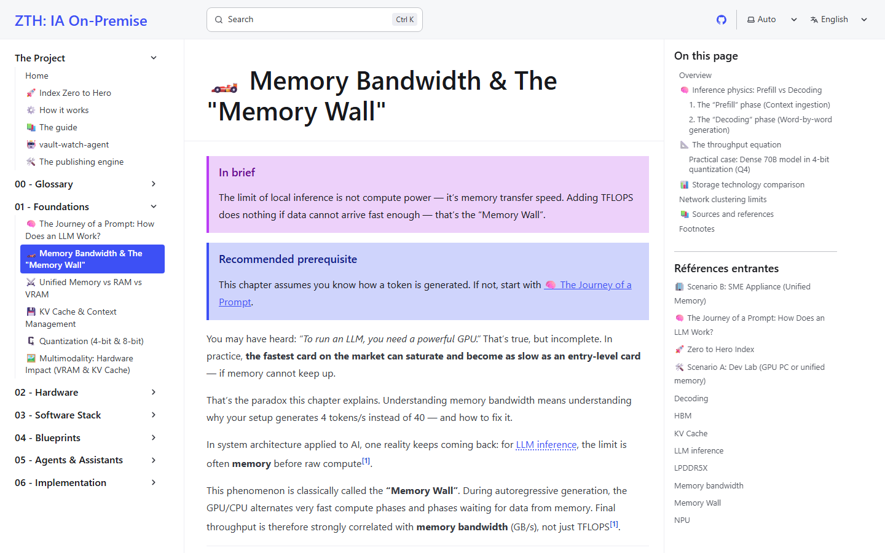

<div align="center">

# Starlight Obsidian Engine

**Français** · [English](README.md) · [Sécurité](SECURITY.fr.md)

**Publier un vault Obsidian en site statique rapide et multilingue, avec le contenu et le moteur entièrement séparés.**

[](https://astro.build)
[](https://starlight.astro.build)
[](https://mermaid.js.org)
[](https://starlight.astro.build/guides/i18n/)
[](./LICENSE)
[](#contribuer)
[](https://github.com/DamienBecherini/starlight-obsidian-engine/actions/workflows/ci.yml)

**[Voir le site en ligne → ia-on-prem.damien.becherini.fr](https://ia-on-prem.damien.becherini.fr)**

</div>

---

Un **moteur générique Astro + Starlight** qui transforme un ou plusieurs vaults **Obsidian** en sites de
documentation statiques, rapides et multilingues. Le moteur (ce dépôt) et le contenu (vos vaults) vivent dans des
**dépôts séparés** : vous rédigez vos notes dans Obsidian, le moteur les publie.



**En production :** ce moteur publie le guide
[Zero to Hero : IA On-Premise](https://ia-on-prem.damien.becherini.fr)
([dépôt du vault](https://github.com/DamienBecherini/ia-on-prem-vault)), environ 280 notes en français et en anglais.
213 tests unitaires (`node --test`) et un build de vérification tournent à chaque push et à chaque pull request ; un
workflow hebdomadaire construit les vrais vaults publics pour repérer les régressions du chargeur ; les déploiements
sont incrémentaux, en FTPS ou en SFTP.

## Pourquoi ?

- **Séparation complète** : le moteur ne contient aucune note. Chaque vault est résolu au moment du build par le
  registre `VAULT_<nom>` ou l'option `--vault=<nom>` ; `VAULT_PATH` sert de repli pour un vault unique.
  Une jonction (`src/content/docs`) est facultative et ne sert qu'à la résolution des chemins dans l'éditeur.
- **Obsidian d'abord** : vous écrivez avec des wiki-links `[[...]]`, des modèles et des diagrammes Mermaid ; le rendu
  web suit.
- **Mermaid interactif** : zoom à la molette ou par boutons, déplacement et plein écran grâce à un `MermaidEnhancer`
  maison construit sur `svg-pan-zoom`.
- **Multilingue** : routage i18n prêt à l'emploi (langues définies par la configuration du vault).
- **Configuration côté contenu** : titre, URL publique, langues, barre latérale et liens sociaux sont dans
  `site.config.json` à la racine du vault, pas dans le moteur.

## Architecture

```
Webdev/
├─ starlight-obsidian-engine/   ← ce dépôt (moteur, partagé)
├─ ia-on-prem-vault/            ← vault A (contenu, public)
│   ├─ site.config.json         (titre, url, langues, barre latérale, liens sociaux)
│   ├─ index.mdx
│   └─ 01-fondations/…
└─ software-craft-vault/        ← vault B (contenu, privé)
    ├─ site.config.json
    └─ …
```

Le moteur résout le contenu du vault au moment du build à partir du registre `VAULT_<nom>` de `.env` ou de l'option
`--vault=<nom>`. `VAULT_PATH` sert de repli pour un vault unique (rétrocompatibilité). Aucun fichier n'est modifié à
l'exécution : le chemin du vault est résolu **en mémoire uniquement**.

Une jonction (`src/content/docs → vault`) est **facultative** : créez-la avec `npm run link:vault` si vous voulez que
l'éditeur résolve les chemins (Vite `preserveSymlinks`) des imports `.mdx` à l'intérieur du vault. Elle n'est jamais
nécessaire pour `dev`, `build` ou `publish`.

**Node.js 22 ou plus récent requis** (le CI utilise Node 24). Le moteur s'appuie sur `node:test` (l'exécuteur de tests
intégré) et sur `parseEnv` de `node:util`.

## Démarrage rapide

```bash
# 1. Cloner le moteur et placer votre ou vos vaults Obsidian à côté
git clone https://github.com/DamienBecherini/starlight-obsidian-engine.git
cd starlight-obsidian-engine

# 2. Déclarer votre ou vos vaults
cp .env.example .env
# Un seul vault : VAULT_PATH=../votre-vault-obsidian
# Plusieurs vaults : ajouter des lignes VAULT_<nom>=<chemin> (voir .env.example)

# 3. Installer
npm install

# 4. Lancer
npm run dev                     # utilise VAULT_PATH (repli pour un vault unique)
npm run dev:ia-on-prem          # utilise VAULT_ia-on-prem (plusieurs vaults)
```

> **Jonction facultative.** `npm run link:vault` crée `src/content/docs → VAULT_PATH` pour la résolution des chemins
> dans l'éditeur. Elle **n'est pas nécessaire** pour `dev`, `build` ou `publish`.

## Configuration du site (`site.config.json`, dans le vault)

```jsonc
{
  "title": "Mon site",
  "url": "https://docs.example.com",
  "defaultLocale": "root",
  "locales": {
    "root": { "label": "English", "lang": "en" },
    "fr": { "label": "Français", "lang": "fr" }
  },
  "social": [{ "icon": "github", "label": "GitHub", "href": "https://github.com/..." }],
  "sidebar": [ /* format de barre latérale Starlight */ ]
}
```

Le moteur lit `url` au moment du build et en fait l'option `site` d'Astro (sitemap, URL canoniques). Omettez `url` si
le site reste local pendant le développement.

### Note de pied de page facultative (`site.config.json`)

Une courte note, la même sur tout le site, sous chaque page (comment le contenu est rédigé, licence…), traduite par
langue :

```jsonc
"footer": {
  "text": "Contenu rédigé avec l'assistance d'une IA, sous direction humaine.",
  "links": [{ "label": "Licence", "href": "https://github.com/.../LICENSE" }],
  "translations": { "en": { "text": "Written with AI assistance, under human direction.", "links": [] } }
}
```

### Avis des lecteurs, facultatif (`site.config.json`)

Une carte sous chaque page, « Donner mon avis », ouvre une fenêtre où le lecteur donne une note sur cinq, dit sur
quoi porte son avis (le site entier ou cette page ; la rédaction, un contenu dépassé, une erreur, la structure,
l'apparence, le sujet) et écrit un message. Tout est facultatif.

```jsonc
"feedback": {
  "email": "avis@example.com",            // un e-mail, depuis la messagerie du lecteur : privé, sans compte
  "repository": "owner/mon-coffre",       // un ticket de ce dépôt GitHub : public, avec un compte GitHub
  "rating": true,                         // demander une note sur cinq (par défaut : true)
  "topics": true                          // demander sur quoi porte l'avis (par défaut : true)
}
```

Donnez `email`, `repository` ou les deux ; sans aucun des deux, ou sans le bloc, rien n'est affiché. Le site
n'envoie rien et ne garde rien : le lecteur voit le texte d'abord, puis l'envoie avec sa propre messagerie ou son
propre compte GitHub, ou le copie. L'e-mail et le ticket contiennent ce que le lecteur a choisi, et le titre et
l'adresse de la page seulement quand l'avis porte sur cette page. Les libellés existent en français et en anglais
(les autres langues reçoivent l'anglais). L'adresse est écrite dans les pages du site : prenez-en une faite pour ça.

La note de la langue par défaut s'affiche quand une langue n'a pas de traduction. Sans bloc `footer`, rien n'est
affiché.

### Règles Apache facultatives (`site.config.json`)

Sur un hébergement Apache (o2switch, cPanel…), le moteur peut générer les règles du site dans un `.htaccess` :

```jsonc
"apache": {
  "forceHttps": true,          // 301 http:// → https:// (garde X-Forwarded-Proto contre les boucles derrière un proxy)
  "notFoundPage": "/404.html", // ErrorDocument 404 : sert la page 404 du site
  "notFoundPages": { "/en/": "/en/404/" }, // page 404 par préfixe (remplace notFoundPage sous /en/)
  "hsts": true,                // Strict-Transport-Security, réponses HTTPS seulement ; true = 1 an, ou un nombre de secondes
  "directoryListing": false,   // Options -Indexes : les dossiers sans page d'index ne sont pas listés
  "mergeSlashes": true,        // 301 /a//b/ → /a/b/ : une seule URL par page
  "redirects": { "/01-fondations/index/": "/01-fondations/" } // 301 exactes pour les pages déplacées
}
```

Le moteur construit une page 404 traduite à `/<langue>/404/` pour chaque langue autre que la racine (Starlight ne
construit que le `404.html` racine) ; faites pointer `notFoundPages` vers elles. Elles restent hors du sitemap et de la
recherche. HSTS ne vise que l'hôte (ni `includeSubDomains` ni `preload`) : un navigateur qui l'a reçu continue
d'utiliser https:// pour cet hôte jusqu'à l'expiration de `max-age`, donc ne l'activez qu'une fois https fonctionnel
partout.

Sans ce bloc (ou avec toutes les options désactivées), rien n'est généré : le comportement reste inchangé. Le
déploiement n'envoie jamais les fichiers cachés (dotfiles) ; les règles arrivent donc sur le serveur par une commande
dédiée :

| Site | Commande | Contenu du `.htaccess` |
|------|----------|------------------------|
| Public | `npm run htaccess:install` | règles du site seules (refuse de s'exécuter si `AUTH_USER` / `AUTH_PASSWORD` / `AUTH_SERVER_ROOT` est défini) |
| Privé | `npm run auth:install` | règles du site, puis Basic Auth (voir [Site privé](#site-privé-basic-auth)) |
| Passage en public | `npm run auth:remove` | remplacé par les seules règles du site au lieu d'être supprimé |

Relancez-les après chaque modification du bloc `apache`. Les vaults appellent les scripts du moteur par leur propre
`scripts/delegate.mjs` : ajoutez `htaccess-install` à ses commandes autorisées et un script npm
`"htaccess:install": "node scripts/delegate.mjs htaccess-install"` pour l'utiliser depuis le vault.

### Fichiers statiques (`public/` dans le vault)

Les fichiers du dossier `public/` du vault sont servis à la racine du site : `public/shot.png` devient `/shot.png`, en
`dev` comme dans le build. Un fichier du vault remplace un fichier du moteur portant le même nom. Les fichiers cachés
(dotfiles), les liens symboliques et les chemins exclus par `publish.exclude` ou par le `.gitignore` du vault ne sont
pas publiés. `npm run audit:links` accepte les liens vers ces fichiers. Relancez `npm run dev` après en avoir ajouté un.

## SEO

- **`robots.txt`** : généré au build (`src/pages/robots.txt.ts`) : `User-agent: *` / `Allow: /`, plus
  `Sitemap: <url>/sitemap-index.xml` quand `url` est défini. Ne placez pas de `robots.txt` dans le `public/` du vault.
- **JSON-LD** : chaque page porte un `<script type="application/ld+json">` : un `WebSite` sur la page d'accueil
  (splash), un `Article` ailleurs (headline, description, `inLanguage`, `url` canonique, `dateModified` tiré du
  frontmatter `last_modified`, `author` tiré de `editorial.hitl`, `isPartOf` le site). `<` est échappé en `<`.
- **Titres** : un emoji en tête du titre d'une page est conservé dans le H1 et la barre latérale, mais retiré de
  `<title>`, `og:title` et `twitter:title` (middleware de route Starlight `src/starlight-route-data.mjs`), pour que les
  résultats de recherche consacrent leur largeur aux mots.
- **Balises sociales** : Starlight émet déjà `twitter:card` ; `Head.astro` n'ajoute que ce qui manque (`og:image` /
  `twitter:image` à partir de `ogImage`, `author`, `article:*`).

### Indexation par les moteurs de recherche (`seo` dans `site.config.json`, `noindex` dans le frontmatter)

Tenir des pages à l'écart des moteurs de recherche tout en les gardant publiées (liens, infobulles du lexique,
recherche interne) :

```jsonc
"seo": {
  "noindex": ["00-lexique/**", "!00-lexique/ai-glossary", "!00-lexique/index-lexique"]
}
```

- Les motifs suivent la syntaxe de `.gitignore`, sur le chemin de la page sans extension, écrit une seule fois sous sa
  forme dans la langue par défaut : ils couvrent aussi chaque miroir traduit (`en/00-lexique/...`). `!` réintègre une
  page.
- Le frontmatter d'une page l'emporte sur les motifs : `noindex: true` l'exclut, `noindex: false` la fait indexer
  quand même.
- Une page exclue reçoit `<meta name="robots" content="noindex, follow">` (ses liens restent suivis) et sort du
  sitemap, liens alternatifs compris.
- Chaque entrée restante du sitemap reçoit un `<lastmod>` tiré du `last_modified` du frontmatter de la page.

### Lexique facultatif (`site.config.json`)

Un vault peut déclarer un bloc `lexicon` dans `site.config.json` pour activer la génération automatique d'un index :

| Champ | Rôle |
|-------|------|
| `enabled` | `true` active l'outillage du lexique (désactivé par défaut si le bloc est absent) |
| `directory` | Dossier des pages de termes (ex. `glossary/` ou `00-lexique/`) |
| `entryTag` | Tag de frontmatter qui marque les entrées du lexique (par défaut : `lexique`) |
| `hubPage` | Fichier markdown de la page d'accueil du lexique, rédigée à la main (exclue de l'index généré) |
| `indexPage` | Nom du fichier de l'index alphabétique généré |
| `sortLocale` | Langue `localeCompare` pour trier les titres (ex. `fr`, `en`) |
| `tooltips` | Infobulles de définition sur les liens vers les entrées (par défaut : `true` ; `false` les désactive) |
| `index.title`, `index.description`, `index.intro` | Frontmatter et introduction de l'index généré |
| `index.hubLink` | `{ "path", "label" }` de la page d'accueil ; ajouté sous l'introduction seulement si celle-ci n'y renvoie pas déjà |
| `index.translations.<langue>` | `title`, `description`, `intro` (et éventuellement `hubLink`) d'un index traduit |

`predev` et `prebuild` ne lancent le générateur d'index que si `lexicon.enabled` vaut true et que le dossier existe.
Chaque entrée doit avoir `title`, `description` et le `entryTag` configuré dans son frontmatter. Le `.gitignore` du
vault est respecté (les fichiers ignorés sont sautés). L'en-tête du tableau suit la langue de `sortLocale`
(« Terme | Définition » pour `fr*`, « Term | Definition » sinon).

Pour chaque langue qui a une entrée `index.translations` et un dossier miroir (`<langue>/<directory>/`), le générateur
écrit aussi `<langue>/<directory>/<indexPage>` : les entrées viennent du miroir (titre et description traduits, liens
vers `/<langue>/<directory>/<slug>/`, en-tête dans la langue, tri selon le `lang` de la langue). Une entrée de la langue
par défaut sans miroir reste listée, à partir de l'entrée par défaut, avec un lien vers la page dans la langue par
défaut et le code de cette langue (ex. `(FR)`).

```bash
npm run lexicon:index          # strict : erreur si le lexique est désactivé ou mal configuré
npm run lexicon:voir-aussi     # met en forme les wiki-links des sections ## Voir aussi des entrées
```

Commitez les pages d'index générées avec le vault quand vous ajoutez ou modifiez des entrées. Les liens de la barre
latérale vers la page d'accueil et l'index se définissent dans `site.config.json` (le moteur ne les génère pas).

#### Infobulles du lexique

Avec le lexique activé (et `tooltips` différent de `false`), chaque lien du contenu rendu qui pointe vers une entrée
(`/<directory>/<slug>/` ou `/<langue>/<directory>/<slug>/`, wiki-links compris) porte la `description` du frontmatter
de l'entrée : un lecteur arrivé sur n'importe quelle page voit ce que signifie un terme sans la quitter.

- **Au build** (`config/rehype/lexicon-tooltips.mjs`) : le lien reçoit `data-lexicon-def`, la classe `lexicon-term`
  et un `aria-describedby` qui pointe vers un élément masqué contenant la description (les lecteurs d'écran
  l'annoncent ; Pagefind l'ignore). La description est prise dans la langue de la page (`en/<directory>/<slug>.md`
  pour une page `en/`), avec repli sur l'entrée de la langue par défaut. Les liens sans description, les liens de la
  page `indexPage` générée et les liens d'une entrée vers elle-même restent tels quels.
- **Côté navigateur** (`src/components/LexiconTooltips.astro`, sans bibliothèque) : une seule bulle en position fixe,
  affichée au survol et au focus clavier ; sur écran tactile, le premier appui affiche la définition (avec un lien vers
  l'entrée) et le second suit le lien. Les clics de souris ne sont jamais interceptés ; Échap ou un appui à côté la
  ferme. Elle utilise les variables de thème de Starlight, reste dans la fenêtre et est masquée à l'impression.

Les descriptions sont lues au démarrage du processeur Markdown : relancez `npm run dev` après les avoir modifiées.

### Liens internes localisés

Les miroirs placés sous un dossier de langue gardent les chemins du vault sous leur forme dans la langue par défaut
(`[[00-lexique/mla|MLA]]` dans `en/01-x/page.md`). Au rendu (`config/rehype/localized-links.mjs`), chaque lien interne
relatif à la racine d'une page sous `<langue>/` (wiki-links et liens Markdown `](/chemin/)`) pointe vers
`/<langue>/<chemin>` quand cette page traduite est publiée ; sinon il garde l'URL de la langue par défaut et reçoit un
`hreflang` égal au `lang` de la langue par défaut. La forme du href est conservée (slash final, `.md`, paramètres,
`#ancre`) ; les liens déjà sous un dossier de langue, les liens externes, les fichiers et les chemins inconnus ne sont
pas touchés. Les pages de la langue par défaut ne sont pas modifiées. La liste des pages publiées est lue au démarrage
du processeur Markdown (relancez `npm run dev` après avoir ajouté un miroir). Les sources ne sont pas réécrites : le
graphe de liens et `npm run audit:links` voient les chemins du vault.

### Prérequis de lecture (frontmatter `prerequisites`)

Une page peut indiquer ce qu'il faut lire avant elle. Les chemins sont des chemins du vault sans extension, écrits une
seule fois sous leur forme dans la langue par défaut :

```yaml
prerequisites: ["01-fondations/memory-bandwidth", "00-lexique/vram"]
```

Un encadré (« 📚 Pour bien lire cette page » / « 📚 Before reading this page ») s'affiche en haut du contenu de la page
(surcharge de `MarkdownContent`) et liste les pages par leur titre. Les liens sont résolus dans la langue de la page
(page `en/` → `/en/...` et titre anglais), avec repli sur la page de la langue par défaut quand il n'y a pas de miroir.
Un miroir traduit sans `prerequisites` propre hérite de la liste de sa page dans la langue par défaut. Les chemins
inconnus sont sautés avec un avertissement au build ; le build n'échoue jamais pour eux. Les libellés sont intégrés :
en français pour les pages `fr*`, en anglais pour toutes les autres langues. L'encadré reste visible à l'impression.

### Rétroliens (références entrantes)

Pendant `predev` / `prebuild`, le moteur construit `src/generated/link-graph.json` (ignoré par git) à partir des
wiki-links explicites et des liens markdown internes `](/chemin/)` des pages **publiées** du vault. La barre latérale
de droite affiche les **références entrantes** sur chaque page ; les entrées du lexique (`lexicon.entryTag`) affichent
**les pages qui mentionnent ce terme**, regroupées par dossier de premier niveau. Les pages d'accueil et d'index du
lexique déclarées dans `site.config.json` → `lexicon` sont exclues du panneau.

Seuls les **liens explicites** comptent (pas les simples mentions dans le texte). Comparez avec le panneau des
rétroliens d'Obsidian pour vérifier ponctuellement.

```bash
npm run link-graph:build
```

## Scripts

Le serveur de développement s'arrête de lui-même après une heure sans requête ni modification d'un fichier qu'il
surveille : un aperçu oublié après une session de travail ne garde pas son port ni sa surveillance du vault.
Écrire dans le vault avec l'aperçu à côté compte comme une utilisation ; une page laissée ouverte qui ne demande
rien, non. `DEV_IDLE_EXIT_MINUTES`, dans le `.env` du moteur, règle le délai en minutes ; `0` laisse le serveur
tourner.

| Commande | Rôle |
|----------|------|
| `npm run dev` | Serveur de développement (utilise le repli `VAULT_PATH`) |
| `npm run dev:<nom>` | Serveur de développement pour un vault déclaré (ex. `dev:ia-on-prem`, `dev:craft`) |
| `npm run build` | Build statique (`dist/`) |
| `npm run preview` | Aperçu du build |
| `npm run link:vault` | (Re)crée la jonction `src/content/docs` → `VAULT_PATH` (facultative, navigation dans l'éditeur seulement) |
| `npm run lexicon:index` | Régénère l'index du lexique du vault (`lexicon.indexPage`) à partir du frontmatter des entrées |
| `npm run lexicon:voir-aussi` | Met à niveau les wiki-links des sections `## Voir aussi` des entrées du lexique |
| `npm run link-graph:build` | Régénère `src/generated/link-graph.json` à partir du graphe de liens du vault |
| `npm run audit:links` | Liste les wiki-links et liens MD non résolus ; ne sort en code 1 que sur les échecs inattendus (liste d'exceptions : `.agents/vault-maintenance/link-audit-allowlist.md` du vault) ; `--strict` échoue sur tout lien non résolu, `--warn-only` sort toujours en code 0 |
| `npm run publish` | Synchro git (facultative) → build → envoi sur le serveur (utilise le repli `VAULT_PATH`) |
| `npm run publish:<nom>` | Publication complète d'un vault déclaré (ex. `publish:ia-on-prem`, `publish:craft`) |
| `npm run deploy` | Build + envoi, sans git (utilise le repli `VAULT_PATH`) |
| `npm run deploy:<nom>` | Build + déploiement d'un vault déclaré (ex. `deploy:ia-on-prem`, `deploy:craft`) |
| `npm run upload` | Envoi seul (`dist/` existant, sans git ni build) |
| `npm run auth:install` | Protège le site en ligne par Basic Auth Apache (voir [Site privé](#site-privé-basic-auth)) |
| `npm run auth:remove` | Retire la Basic Auth (le site redevient public ; les règles `apache` du site sont conservées) |
| `npm run htaccess:install` | Envoie les règles `apache` du site dans le `.htaccess` (site public ; voir [Règles Apache](#règles-apache-facultatives-siteconfigjson)) |
| `npm test` | Tests unitaires (manifeste de déploiement, gitignore, graphe de liens, lexique, auth, options de ligne de commande) |
| `npm run test:build` | Build de vérification sur `tests/fixtures/minimal-vault/` |

Toutes les commandes `publish`, `deploy` et `upload` acceptent aussi directement l'option `--vault=<nom>` :

```bash
npm run publish -- --vault=craft
npm run deploy  -- --vault=ia-on-prem
```

## Tests

Lancer la suite de tests unitaires (exécuteur de tests intégré à Node, sans dépendance supplémentaire) :

```bash
npm test
```

Build de vérification du site Astro sur un vault minimal inclus dans le dépôt (exclut `_private/` et les chemins du
`.gitignore`). Il utilise `FORCE_VAULT_PATH=1` pour que ce vault de test l'emporte sur la jonction
`src/content/docs`, et écrit le résultat dans un dossier jetable sous `node_modules/.cache/` (jamais `dist/`, jamais le
lien vers le vault) :

```bash
npm run test:build
```

**Couvert :** différence du manifeste de déploiement incrémental, filtrage gitignore / `_private` du vault, exclusions
du chargeur de documents du vault, forçage du chemin du vault (`FORCE_VAULT_PATH`), options de ligne de commande du
déploiement, lecture de la configuration de déploiement (cas nominaux), génération `apr1` / htpasswd Apache, règles
`.htaccess` du site et lecture du bloc `apache`, robots.txt, JSON-LD et retrait des emojis des titres, motifs noindex et réécriture du sitemap, redirections du `.htaccess`, affichage de la
progression de l'envoi, lancement de npm sans shell, vérification de la clé du serveur SFTP, chemins dangereux du manifeste. Le build de vérification contrôle aussi `robots.txt`, le bloc
JSON-LD, la présence d'un seul `twitter:card` et le `<title>` sans emoji.

**Non couvert (volontairement) :** les vrais transferts FTPS/SFTP, les questions git interactives de `publish.mjs`, le
`MermaidEnhancer` côté navigateur. Le CI lance `npm test` et `npm run test:build` à chaque push et pull request
(`.github/workflows/ci.yml`).

## Publication

Sauvegardez sur GitHub et/ou déployez le site construit en **FTPS** (FTP sur TLS) ou en **SFTP** (SSH).
**Les identifiants de déploiement sont dans le `.env` du vault** : chaque vault peut viser un hôte différent. Le `.env`
du moteur n'a besoin que de `VAULT_PATH`.

### Résumé du flux

```
npm run publish
  ├─ vérifie la configuration de déploiement (échec immédiat, avant git et build)
  ├─ git du vault   (annuler / commiter / passer / push s'il est en avance)
  ├─ git du moteur  (idem)
  ├─ npm run build
  └─ envoi FTPS/SFTP incrémental (`.deploy-manifest.json` local et distant)

npm run deploy  →  vérification de la config → build → envoi incrémental (manifeste synchronisé)
npm run upload  →  vérification de la config → envoi incrémental (dist/ doit déjà exister ; lancez le build avant)
npm run audit:links  →  liens non résolus (code 1 seulement sur l'inattendu ; --strict pour une tolérance zéro)
```

### Configuration

**Moteur** (`starlight-obsidian-engine/.env`) :

```env
# Un seul vault (repli)
VAULT_PATH=../votre-vault-obsidian

# Registre multi-vault : déclarez chaque vault avec VAULT_<nom>=<chemin>
# Utilisé par : l'option --vault=<nom>, npm run dev:<nom>, npm run publish:<nom>, etc.
# VAULT_ia-on-prem=../ia-on-prem-vault
# VAULT_craft=../software-craft-vault
```

**Vault** (`votre-vault/.env`) :

```env
ENGINE_PATH=../starlight-obsidian-engine

# ftps = FTP sur TLS (port 21, sans SSH). sftp = SSH (port 22).
DEPLOY_PROTOCOL=ftps

DEPLOY_HOST=ftp.example.com
DEPLOY_PORT=21
DEPLOY_USER=votre-utilisateur
DEPLOY_PASSWORD=votre-mot-de-passe
# SFTP seulement : clé privée au lieu du mot de passe
# DEPLOY_PRIVATE_KEY_PATH=id_ed25519
# SFTP seulement : clé SSH attendue du serveur (ssh-keygen -lf, ou affichée au premier déploiement) ; une autre est refusée
# DEPLOY_HOST_FINGERPRINT=SHA256:...

# FTPS : beaucoup d'hébergements mutualisés présentent un certificat pour un autre nom (ex. *.o2switch.net).
# FileZilla l'accepte sans rien dire ; cette ligne fait de même :
# DEPLOY_FTPS_INSECURE=true

DEPLOY_REMOTE_PATH=/
```

> Les anciens noms `SFTP_*` (`SFTP_HOST`, `SFTP_USER`, …) sont encore acceptés en repli, mais `DEPLOY_*` est le nommage
> de référence, indépendant du protocole.

Si `DEPLOY_PROTOCOL` est omis, le port `21` choisit `ftps` et le port `22` choisit `sftp`.

Partez du `.env.example` de chaque dépôt. Vérifiez que le dossier distant existe sur votre hébergement.

**Chemin distant et chroot FTPS.** Les comptes FTPS sont presque toujours **enfermés (chroot)** dans leur propre
espace : après connexion, le dossier courant est déjà la racine web du site, utilisez donc `DEPLOY_REMOTE_PATH=/`.
Ne recopiez **pas** le chemin absolu `/home/UTILISATEUR/site` affiché dans FileZilla : il est relatif au chroot et
imbriquerait l'envoi dans lui-même. Le moteur affiche la **cible absolue résolue** avant l'envoi pour que vous puissiez
la vérifier. En SFTP, `/` est la vraie racine du serveur : utilisez plutôt un dossier absolu dédié.

**Entrées protégées.** À la racine du site FTPS, les entrées gérées par le serveur ne sont jamais envoyées ni
supprimées par le miroir : tous les fichiers cachés (`.htaccess`, `.well-known`, `.ftpquota`) plus une liste
configurable (`DEPLOY_PROTECT`, par défaut `cgi-bin`).

### Commandes

| Commande | Git | Build | Envoi | Usage type |
|----------|-----|-------|-------|------------|
| `npm run publish` | oui (interactif ou par options) | oui | oui | Flux complet : sauvegarde + mise en ligne |
| `npm run deploy` | non | oui | oui | Reconstruire et envoyer après des modifications locales |
| `npm run upload` | non | non | oui | Envoyer un `dist/` existant seulement |

Les trois fonctionnent **depuis le moteur ou depuis le vault** (les scripts du vault délèguent au moteur).

```bash
# Depuis le moteur
npm run publish
npm run deploy
npm run upload

# Depuis le vault (mêmes commandes, déléguées via ENGINE_PATH)
cd ../votre-vault-obsidian
npm run upload
```

### Git interactif (`publish` seulement)

Dans un terminal, chaque dépôt qui a des **modifications non commitées** pose la question :

1. **Annuler** : tout s'arrête (rien n'est déployé)
2. **Commit automatique** : demande un message de commit, puis commite et pousse ce dépôt
3. **Publier quand même** : saute git pour ce dépôt (les fichiers locaux sont déployés ; GitHub reste en retard)

Les dépôts propres mais **en avance sur origin** sont poussés automatiquement.

### Déploiement incrémental (par défaut)

Par défaut, `deploy`, `upload` et `publish` s'appuient sur un **manifeste de déploiement** (SHA-256 de chaque fichier du
dernier déploiement réussi) :

- **Copie locale :** `.deploy-manifest.json` à la racine du vault (ignoré par git).
- **Copie distante :** même nom de fichier, à `{DEPLOY_REMOTE_PATH}/.deploy-manifest.json` (fichier caché à côté du
  contenu de `dist/` ; envoyé directement, il ne fait pas partie du site statique).

Avant chaque envoi incrémental, le moteur **récupère le manifeste distant** (s'il existe) et le fusionne avec la copie
locale : le distant l'emporte si la copie locale est absente (CI, nouveau clone) ; sinon, le plus récent selon
`updatedAt` l'emporte. Après chaque envoi ou suppression, les deux copies sont mises à jour.

Après `npm run build`, le moteur calcule l'empreinte de chaque fichier de `dist/` et la compare au manifeste fusionné :

- **Envoie** seulement les fichiers nouveaux ou modifiés (aucun listage FTP distant : l'aperçu est immédiat).
- **Supprime** les fichiers distants qui ne sont plus dans `dist/` (anciens bundles `_astro`, anciens fragments
  Pagefind, etc.).
- **Met à jour les deux manifestes** après chaque fichier envoyé ou supprimé (on peut reprendre sans risque si la
  connexion FTPS tombe en plein transfert).

Le premier déploiement vers une cible envoie tout et crée les deux manifestes. Si vous changez `DEPLOY_HOST` ou
`DEPLOY_REMOTE_PATH`, le manifeste est remis à zéro automatiquement pour la nouvelle cible.

En **SFTP**, les fichiers modifiés partent en parallèle (jusqu'à 8 `put` simultanés sur une seule connexion).

Exemple d'aperçu :

```
🔍 Incremental deploy (manifest sync)
   Syncing manifest from remote…
   Hashing dist/ … 274/274

📋 Planned changes (incremental, synced manifest):
   + upload:     12 file(s) (420.5 KB)
   ~ skip:       262 unchanged
   − delete:     8 obsolete remote file(s)
```

### Déploiement complet (`--full`)

L'ancien comportement : parcourt l'arborescence distante (~10 s en FTPS), envoie **tout** `dist/`, puis parcourt le
serveur en miroir pour retirer les fichiers périmés. Régénère les manifestes **local et distant** à la fin. À utiliser
après des modifications manuelles sur l'hébergement, un manifeste corrompu, ou pour tout resynchroniser :

```bash
npm run deploy -- --full
npm run publish -- --full --yes
```

### Aperçu et confirmation

La question de confirmation s'affiche dans un terminal. Sautez-la avec `--yes` (ou `-y`) pour un lancement non
interactif ; hors terminal (CI), l'envoi se fait sans question.

Pendant le transfert, le moteur affiche une **barre de progression** sur une seule ligne (en octets transférés en FTPS,
en nombre de fichiers en SFTP). Elle n'apparaît que dans un terminal interactif ; les journaux redirigés ou de CI
restent propres.

### Nettoyage des orphelins et `--no-mirror`

Par défaut, le déploiement incrémental **supprime les fichiers distants périmés** suivis dans le manifeste (même but
que le miroir, sans parcours complet de l'arborescence distante). Les fichiers cachés et les entrées protégées de
premier niveau (`DEPLOY_PROTECT`, par défaut `cgi-bin`) ne sont jamais touchés.

Garder les fichiers distants périmés (envoi additif) :

```bash
npm run upload -- --no-mirror     # alias : --additive
npm run deploy -- --no-mirror
npm run publish -- --no-mirror

# sauter la question de confirmation
npm run deploy -- --yes
```

### Options non interactives (`publish` seulement)

```bash
npm run publish -- --commit-message "Mise à jour des notes"
npm run publish -- --skip-git          # build + envoi, sans git
npm run publish -- --help
```

`deploy` et `upload` ne touchent jamais à git.

### Site privé (Basic Auth)

> **Apache seulement.** Cette fonction génère des fichiers `.htaccess` et `.htpasswd`. Elle fonctionne sur les
> hébergements mutualisés Apache (o2switch, OVH mutualisé, cPanel, etc.). Elle **n'a aucun effet** sur Nginx, Caddy,
> Vercel, Netlify, AWS S3 ou tout hébergement qui ne lit pas les `.htaccess`.

Rendez le site déployé privé avec la Basic Auth d'Apache. Le moteur génère un `.htpasswd` (empreinte Apache `$apr1$`
MD5, salée) et un `.htaccess`, puis envoie les deux à la racine du site par la même connexion `DEPLOY_*`.

Ajoutez au `.env` du **vault** :

```env
AUTH_USER=lecteur
AUTH_PASSWORD=un-mot-de-passe-solide
# Vrai chemin absolu de la racine du site sur le serveur (celui que voit Apache). Sur un compte FTP
# enfermé (chroot), "/" correspond à ce chemin : recopiez-le depuis cPanel ou votre hébergeur :
AUTH_SERVER_ROOT=/home/UTILISATEUR/dossier-du-site
# AUTH_HTPASSWD_NAME=.htpasswd   # nom du fichier à la racine du site (doit rester caché)
AUTH_REALM=IA On-Premise          # texte de la fenêtre de connexion du navigateur
```

```bash
npm run auth:install                 # génère et envoie .htpasswd puis .htaccess
npm run auth:remove                  # supprime .htaccess (ou le ramène aux règles apache du site) et .htpasswd
npm run auth:remove -- --keep-htpasswd   # supprime seulement .htaccess
npm run auth:remove -- --yes             # saute la question de confirmation
```

Après l'installation, le site répond **401** sans identifiants et **200** avec la paire `AUTH_USER` / `AUTH_PASSWORD`.

Remarques :

- Les identifiants de lecture sont **indépendants** du compte FTP (`DEPLOY_USER`) : moindre privilège.
- `.htpasswd` est à la racine du site dans le chroot (pour que FTP puisse l'écrire), mais c'est un fichier caché :
  jamais servi par Apache, jamais envoyé ni supprimé par le miroir de `deploy` / `upload`. Le `.htaccess` généré
  interdit aussi tout fichier `^\.ht`.
- `AUTH_SERVER_ROOT` est le **vrai chemin absolu** utilisé pour `AuthUserFile` (Apache lit le vrai système de
  fichiers, pas la vue du chroot), distinct de `DEPLOY_REMOTE_PATH=/` utilisé par FTP.
- Les fichiers sont envoyés depuis la mémoire : le mot de passe haché n'est jamais écrit sur le disque local.
- Avec un bloc `apache` dans `site.config.json`, ses règles sont placées avant celles de la Basic Auth. Avec
  `forceHttps`, les identifiants ne sont demandés qu'en HTTPS (`<If>` sur la même condition que la redirection) :
  `http://` est redirigé avant qu'un mot de passe ne parte en clair.

### Notes et limites

- **Le miroir est le comportement par défaut** (les fichiers distants absents en local sont supprimés). Utilisez
  `--no-mirror` pour un envoi additif. En SFTP, `DEPLOY_REMOTE_PATH` doit être un dossier dédié (le miroir refuse la
  racine du serveur).
- **Les fichiers cachés sont ignorés** à l'envoi de `dist/` et **jamais supprimés** par le miroir (ce qui protège
  `.htaccess`, etc.) ; le manifeste de déploiement (`.deploy-manifest.json`) est géré à part et stocké à la racine du
  déploiement distant ; en FTPS, `DEPLOY_PROTECT` (par défaut `cgi-bin`) ajoute des entrées de premier niveau protégées.
- **URL publique :** définissez `url` dans le `site.config.json` du vault (pas dans le moteur). Elle active le sitemap
  et les URL canoniques absolues au build.

### Notes privées ou non publiées

Le moteur exclut du site les fichiers Markdown/MDX dont le chemin correspond à l'une de ces règles :

1. **Règles en dur** : `README.md` / `readme.txt` à la racine du vault, et toute l'arborescence `_private/` (même si
   elle est réincluse par une négation dans `.gitignore`).
2. **`publish.exclude` dans `site.config.json`** : chemins versionnés qui doivent rester hors du site public (plans
   d'agents, skills, règles Cursor, etc.).
3. **Le `.gitignore` du vault** : fichiers qui ne doivent être ni commités ni publiés.

Le déploiement n'envoie que `dist/` : les notes exclues n'arrivent jamais sur le web. En mode miroir (par défaut), les
pages publiées auparavant mais désormais exclues sont **retirées du serveur** au déploiement suivant.

Exemple dans le `site.config.json` du vault :

```json
{
  "publish": {
    "exclude": [
      "docs/plans/**",
      ".agents/**",
      ".cursor/**"
    ]
  }
}
```

Convention dans le vault :

```
README.md          ← documentation du dépôt à la racine du vault (GitHub) ; jamais construite en page du site
_private/          ← notes confidentielles (ignorées par git sauf le fichier témoin _private/README.md)
.gitignore         ← exclusions git (également exclues du build)
site.config.json   ← publish.exclude pour les dossiers versionnés mais non publiés
```

Ajoutez vos chemins au `.gitignore` quand le contenu ne doit pas être dans Git. Utilisez `publish.exclude` quand le
contenu doit être versionné mais pas publié. Ne faites pas référence à des pages privées dans la barre latérale de
`site.config.json`.

Avec `--no-mirror`, les pages exclues déjà en ligne ne sont **pas** supprimées automatiquement du serveur.

## Analyse du build et taille des bundles

`npm run build` affiche un avertissement de Vite : *« Some chunks are larger than 500 kB »*. C'est attendu et **sans
conséquence**. Les seuls morceaux au-delà de 500 kB sont les bundles de Mermaid :

| Morceau | Taille env. | Chargé quand |
|---------|-------------|--------------|
| `mermaid.core.*` | ~590 kB | une page contient un diagramme Mermaid |
| `wardley-*` | ~600 kB | une page contient une carte de Wardley |
| `cytoscape.esm.*` | ~430 kB | dispositions architecture / cose-bilkent |
| `katex.*` | ~255 kB | un diagramme Mermaid contient des formules (côté navigateur, via `astro-mermaid`) |

Ils sont **importés à la demande côté navigateur** par `astro-mermaid` : ils ne sont téléchargés que sur les pages qui
affichent vraiment ce type de diagramme, et ne pèsent donc jamais sur le chargement initial. Ils sont aussi déjà
découpés au mieux par type de diagramme ; les regrouper avec `manualChunks` fusionnerait des bundles chargés à la
demande en un seul bundle chargé d'emblée (pire), et relever `chunkSizeWarningLimit` ne ferait que masquer le message.
Nous ne faisons volontairement ni l'un ni l'autre.

Pour voir ce que contient chaque morceau, lancez un build d'analyse **à la demande** (il écrit `dist/stats.html` et ne
fait jamais partie d'un build ou d'un déploiement ordinaire) :

```bash
# bash / zsh
ANALYZE=true npm run build

# PowerShell
$env:ANALYZE="true"; npm run build; Remove-Item Env:\ANALYZE
```

## Modules intégrés

- **Mermaid** : `src/components/MermaidEnhancer.astro` + `src/styles/mermaid.css` (déplacement, zoom, plein écran) par
  dessus `astro-mermaid`. Voir la skill de débogage fournie dans `.agents/skills/astro-mermaid/`.
- **Rétroliens** : `src/components/PageBacklinks.astro` injecté dans `src/components/PageSidebar.astro` (surcharge du
  `PageSidebar` de Starlight). Lit `src/generated/link-graph.json` construit pendant `predev` / `prebuild`.
- **Badge éditorial** : `src/components/VerifiedBadge.astro` affiche en bas de chaque page les champs de frontmatter
  `last_modified`, `last_verified`, `verified_by`, `verified_hitl` et `prices_valid_as_of`.
- **Mathématiques (LaTeX)** : `remark-math` + `rehype-katex` (`config/markdown.mjs`) pour la syntaxe Obsidian `$...$` /
  `$$...$$`, rendue au build (aucun JS côté navigateur). Styles : `katex/dist/katex.min.css` +
  `src/styles/katex-starlight.css`. Les dollars simples suivent la règle d'Obsidian
  (`config/remark/obsidian-math.mjs`) : pas d'espace après le `$` ouvrant, pas d'espace avant le `$` fermant, pas de
  chiffre après lui. Deux prix dans un paragraphe (« 5 $ … 10 $ », « $5 … $10 ») restent donc du texte.
- **Wiki-links** : `remark-wiki-link` (`config/markdown.mjs`) pour la syntaxe `[[...]]` d'Obsidian.
- **Infobulles du lexique** : `config/rehype/lexicon-tooltips.mjs` (au build) + `src/components/LexiconTooltips.astro`
  (script de la bulle, injecté par `Head.astro`). Voir [Infobulles du lexique](#infobulles-du-lexique).
- **Prérequis de lecture** : `src/components/PrerequisitesBox.astro` dans la surcharge de `MarkdownContent`, à partir
  du frontmatter `prerequisites`. Voir [Prérequis de lecture](#prérequis-de-lecture-frontmatter-prerequisites).
- **i18n** : langues et libellés définis par `site.config.json`.

## Organisation du projet

```
config/               configuration du moteur (résolution du vault, lecture de la config du site, intégrations, markdown, Starlight)
scripts/              lien vers le vault, vérifications avant dev/build, publication (FTPS/SFTP)
src/pages/            point d'entrée robots.txt
src/starlight-route-data.mjs  middleware de route Starlight (<title> sans emoji)
src/components/       surcharges Head, Footer, MarkdownContent, PageSidebar ; MermaidEnhancer, PageBacklinks,
                      VerifiedBadge, LexiconTooltips, PrerequisitesBox, SiteFooterNote, SiteFeedback
src/lib/              aides utilisables dans le navigateur : panneau des rétroliens, avis des lecteurs (texte,
                      liens d'e-mail et de ticket)
src/styles/           surcharges Starlight pour Mermaid, KaTeX, rétroliens, notes de bas de page, liens externes
src/generated/        link-graph.json (ignoré par git ; reconstruit pendant predev/prebuild)
src/content.config.ts collection de contenu (compositeLoader : docsLoader + glob du vault, compatible jonction)
```

## Contribuer

Issues et PR bienvenues. Le moteur est volontairement indépendant du contenu : gardez vos notes dans le dépôt de votre
propre vault.

## Licence

[Licence MIT](./LICENSE) : libre d'utiliser, de modifier et de redistribuer, y compris dans des projets fermés et
commerciaux, à condition de conserver la mention de copyright et le texte de la licence.
